# Documentación técnica completa — EduMaster.ai

**Proyecto académico · SENATI 4.º semestre · Noviembre 2026**  
**Fecha de esta edición:** 2026-11-26  
**Repositorio:** `https://github.com/Maxgab27/EduMaster-AI.git`  
**Rama:** `main` · **Estado al redactar:** sincronizada con `origin/main`  
**Estado del demo:** `GOTY ✅` — listo para sustentación académica, confirmado por el usuario.

> Esta documentación consolidan el análisis, la implementación, las mejoras, los añadidos, las capturas reales y los límites honestos del proyecto. Todo lo mostrado corresponde a un entorno **DEMO** con datos sintéticos. Los certificados, comprobantes y métricas **no son oficiales ni evidencia institucional**.

---

## Índice

1. [Resumen ejecutivo](#1-resumen-ejecutivo)
2. [Alcance, criterios y estado actual](#2-alcance-criterios-y-estado-actual)
3. [Arquitectura general](#3-arquitectura-general)
4. [Estructura del repositorio](#4-estructura-del-repositorio)
5. [Historial de trabajo y commits](#5-historial-de-trabajo-y-commits)
6. [Backend activo](#6-backend-activo)
7. [Frontend](#7-frontend)
8. [Store DEMO y persistencia local](#8-store-demo-y-persistencia-local)
9. [Módulos funcionales en detalle](#9-mdulos-funcionales-en-detalle)
10. [Datos sintéticos y constantes DEMO](#10-datos-sintticos-y-constantes-demo)
11. [Seguridad, gobernanza y trazabilidad](#11-seguridad-gobernanza-y-trazabilidad)
12. [Despliegue en Railway](#12-despliegue-en-railway)
13. [Validación y evidencia técnica](#13-validacin-y-evidencia-tcnica)
14. [Evidencia visual del proyecto](#14-evidencia-visual-del-proyecto)
15. [Matriz de cumplimiento y límites honestos](#15-matriz-de-cumplimiento-y-lmites-honestos)
16. [Comandos reproducibles](#16-comandos-reproducibles)
17. [Conclusión](#17-conclusin)

---

## 1. Resumen ejecutivo

EduMaster.ai es una plataforma web académica de aprendizaje adaptativo construida como proyecto del Seminario de Complementación Práctica I. El caso de uso implementado se centra en dos procesos:

1. **Detección del riesgo de abandono estudiantil**, con un motor de inferencia que combina un modelo de aprendizaje multitarea y una línea base interpretable.
2. **Intervención formativa docente**, materializada en un SpeedGrader con rúbrica, feedback validado, firma docente y auditoría SHA-256.

Alrededor de ese núcleo se construyeron módulos de apoyo: panel de indicadores, cursos, rutas de aprendizaje, analítica, gobernanza, certificados con QR verificable, comunidad, notificaciones, Tutor IA y configuración institucional.

El trabajo se desarrolló con tres principios:

- **Contrato primero:** las respuestas HTTP usan el envelope `{ data, meta }` con `correlationId`.
- **Estado honesto:** todo lo que no es real está rotulado `DEMO`; no se presentan cifras de producción inventadas.
- **Auditoría transversal:** las acciones relevantes generan eventos con actor, rol, correlación y detalle.

El resultado es un sistema funcional en modo demostración, con backend activo en `backend/`, frontend en `frontend/`, documentación versionada, 7 pruebas E2E y un checklist de Railway que el usuario ejecuta por su cuenta. **No se realizó deploy desde esta sesión.**

---

## 2. Alcance, criterios y estado actual

### 2.1 Decisiones de alcance

| Tema | Decisión aplicada |
|---|---|
| Backend activo | `backend/` con FastAPI. La carpeta `api/` se conservó como referencia y no se modificó. |
| Frontend principal | `frontend/` con React 19, TypeScript 7, Vite 8 y Tailwind CSS. |
| Despliegue | Railway como destino obligatorio, pero ejecutado por el usuario. No se usaron `railway link`, `railway up` ni publicación de servicios. |
| Autenticación | Sin Supabase/OIDC. `X-Actor` es opcional y no prueba identidad. |
| Mensajería | Comunidad es local y simulada; sin WebSocket/SSE ni broker real. |
| Datos | Sintéticos, guardados en `localStorage` versionado cuando no hay API. |
| Certificados | QR real y verificable por HTTP, pero folios sintéticos y comprobantes no oficiales. |
| Secretos | No se compartieron credenciales de Supabase, OIDC, Railway ni APIs externas. `frontend/.env.local` está ignorado. |
| Entorno Windows | Se usaron comandos `npm.cmd`. |

### 2.2 Estado actual del repositorio

- Rama `main` con este commit de documentación preparado para sincronizarse con `origin/main`.
- El trabajo se integró mediante rebase con los commits de interfaz `7a93ac4`, `a59738a`, `d6b3d69`, `6268dc3` y `4152ed3`, que llegaron al remoto mientras se redactaba esta guía.
- Después del rebase se reconstruyó `frontend/dist` sin `.env.local`, para que las capturas muestren la interfaz final y no un build anterior.
- `frontend/.env.local` está ignorado por la regla `*.local` en `frontend/.gitignore`.

### 2.3 Estado del demo

El usuario confirmó el estado del sistema como **GOTY ✅**, es decir, listo para la presentación académica. Esta confirmación se registró también en el informe de práctica `.docx` y en `INFORME_DE_TRABAJO_Y_MEJORAS.md`.

---

## 3. Arquitectura general

### 3.1 Diagrama de arquitectura

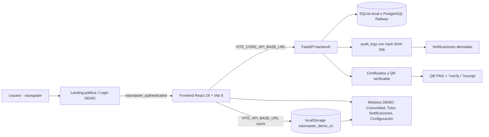

### 3.2 Doble adaptador

Cada servicio del frontend puede trabajar de dos maneras:

| Condición | Comportamiento | Función clave |
|---|---|---|
| `VITE_API_BASE_URL` definido | Llama a `VITE_API_BASE_URL` y exige envelope `{ data, meta }`. | `request()` |
| `VITE_API_BASE_URL` vacío | Usa adaptador local con retardo `DEMO_DELAY_MS = 180`. | `requestWithDemo()` |
| `VITE_CORE_API_BASE_URL` definido | El núcleo real (riesgo, SpeedGrader, firma, auditoría) llama por HTTP. | `requestCore()` |
| `VITE_CORE_API_BASE_URL` vacío | El núcleo usa adaptador DEMO local. | `requestCoreWithDemo()` |

Esto permite que ninguna pantalla quede inutilizable sin backend y que el paso a la API real no obligue a reescribir componentes.

### 3.3 Envelope de respuesta

Toda respuesta HTTP del contrato `/api/v1` usa:

```json
{
  "data": {},
  "meta": {
    "source": "api",
    "generatedAt": "2026-11-26T00:00:00Z",
    "correlationId": "web-..."
  }
}
```

En modo local, `source` es `demo`. El frontend valida que existan `data` y `meta`; si falta uno, lanza `ApiClientError('invalid', ...)`.

### 3.4 Flujo de firma docente

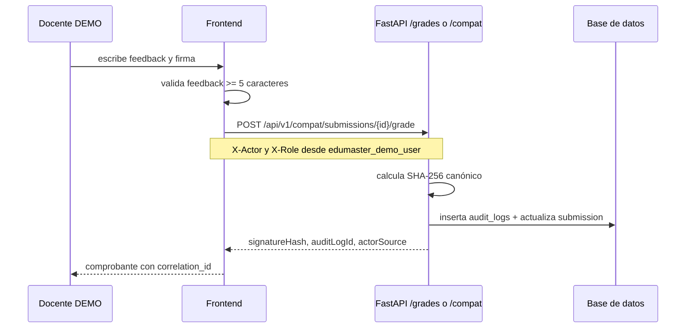

---

## 4. Estructura del repositorio

```text
EduMaster-AI/
├── backend/
│   ├── Dockerfile
│   ├── requirements.txt
│   ├── tests/test_smoke.py
│   └── app/
│       ├── main.py                 # FastAPI, CORS, routers
│       ├── api/v1/
│       │   ├── health.py
│       │   ├── inference.py
│       │   ├── grades.py
│       │   ├── audit.py
│       │   ├── students.py
│       │   └── compat.py           # contrato real del frontend
│       ├── core/
│       │   ├── config.py
│       │   ├── database.py
│       │   └── security.py
│       ├── models/
│       │   ├── audit.py
│       │   ├── certificate.py
│       │   ├── student.py
│       │   └── submission.py
│       ├── schemas/
│       └── services/pytorch_engine.py
├── frontend/
│   ├── dist/                       # build de producción
│   ├── scripts/serve.mjs           # servidor estático para Railway
│   ├── tests/demo-flows.spec.ts    # 7 pruebas E2E
│   ├── playwright.config.ts
│   ├── railway.json
│   └── src/
│       ├── components/
│       │   ├── admin/AdminGovernanceView.tsx
│       │   ├── layout/Sidebar.tsx, Topbar.tsx
│       │   ├── modules/             # Analytics, AITutor, Community, Certificates, etc.
│       │   ├── teacher/             # TeacherDashboard, TeacherSpeedGraderModal
│       │   └── student/             # StudentCodeSandbox
│       ├── services/                # apiClient, demoStore, tutorApi, communityApi, etc.
│       ├── auth/permissions.ts
│       ├── data/mockData.ts
│       └── types/index.ts
├── docs/imagenes/                  # capturas del proyecto
├── api/                            # referencia conservada, no modificada
├── railway.json                    # Config as Code del servicio API
├── RAILWAY.md                      # checklist operativa del usuario
├── README.md
├── FUNCIONALIDADES_Y_MEJORAS.md
├── MATRIZ_CUMPLIMIENTO_DOCUMENTO.md
├── INFORME_DE_TRABAJO_Y_MEJORAS.md
└── DOCUMENTACION_TECNICA_COMPLETA.md
```

---

## 5. Historial de trabajo y commits

| Commit | Hito técnico |
|---|---|
| `324d907` | Aclaración del QR DEMO y su etiqueta de verificación. |
| `e8b9164` | QR escaneable y verificación HTTP. |
| `db38bec` | QR accesible desde celular en la misma red Wi-Fi. |
| `1d17191` | Mejora de vista móvil y preparación para QR público en Railway. |
| `b2d9233` | Informe académico de mejoras de Kevin en PDF. |
| `2ad37d1` | División de bundle, accesibilidad del drawer y errores de API claros. |
| `23acb83` | Preparación Railway: `serve.mjs`, `railway.json`, checklist `RAILWAY.md`. |
| `320c0e8` | Documentación de mensajería comunitaria verificada. |
| `63d8ab6` | Chat de Comunidad con respuestas simuladas y acciones de mensaje. |
| `a0d1661` | Selector `Escribir como` para simular participantes. |
| `46de8be` | Notificaciones derivadas, Tutor IA útil, firma SpeedGrader y CSV reales. |
| `9acf27e` | Preferencias compartidas, respaldo DEMO, badge honesto y Playwright 7/7. |
| `957f21b` | Informe consolidado `INFORME_DE_TRABAJO_Y_MEJORAS.md`. |
| `7a93ac4` | Landing pública y vista de Login DEMO con perfiles de un clic. |
| `a59738a` | Estética glassmorphism y fondo atmosférico difuminado. |
| `d6b3d69` | Mapa de contorno y mayor transparencia de vidrio. |
| `6268dc3` | Topbar ordenada, badge de estado unificado y fondo horizontal. |
| `4152ed3` | Mapa mundial ampliado y centrado, pulsos alineados e inspector de nodos restaurado. |
| `dc05770` | Visualizador neuronal con más espacio y partículas alineadas a las curvas de sinapsis. |
| `ebb34ec` | Actividad reciente con cola fija de 5 eventos y descarte de los más antiguos. |

### 5.1 Tandas de trabajo

1. **Diseño y arquitectura:** problema, roles, contrato, doble adaptador y restricciones de Railway.
2. **Núcleo real:** riesgo de abandono, SpeedGrader, firma SHA-256, auditoría y certificados.
3. **Interfaz y accesibilidad:** bundle dividido, drawer con foco, móvil y landing.
4. **Colaboración DEMO:** Comunidad, selector de identidad y notificaciones.
5. **Trazabilidad útil:** Tutor IA con fuentes, comprobante de firma y CSV descargables.
6. **Cierre:** preferencias compartidas, respaldo JSON, badge honesto y E2E.

---

## 6. Backend activo

### 6.1 Stack

- FastAPI.
- SQLAlchemy async con `aiosqlite` local y `asyncpg` para PostgreSQL.
- Pydantic para validación.
- JWT preparado en `core/security.py`, sin flujo real de autenticación.
- Motor de inferencia en `services/pytorch_engine.py`, con fallback NumPy cuando Torch no está disponible.

### 6.2 Rutas originales

| Método | Ruta | Función |
|---|---|---|
| `GET` | `/` | Información del servicio, versión, modo `DEMO` y caso de uso. |
| `GET` | `/health` | Healthcheck del API. |
| `POST` | `/api/v1/inference/dropout-risk` | Predicción de riesgo de abandono. |
| `POST` | `/api/v1/grades/submit` | Firma oficial de una calificación. |
| `GET` | `/api/v1/audit/logs` | Historial de auditoría. |
| `GET` | `/api/v1/students/at-risk` | Estudiantes en riesgo. |

### 6.3 Rutas del contrato de compatibilidad

| Método | Ruta | Función |
|---|---|---|
| `GET` | `/api/v1/compat/submissions` | Lista de entregas sintéticas. |
| `POST` | `/api/v1/compat/submissions/{id}/grade` | Firma y calificación con hash y audit log. |
| `POST` | `/api/v1/compat/submissions/{id}/feedback` | Guarda feedback sin publicar nota. |
| `GET` | `/api/v1/compat/students/at-risk` | Estudiantes en riesgo con acción sugerida. |
| `GET` | `/api/v1/compat/certificates` | Certificados sintéticos. |
| `GET` | `/api/v1/compat/certificates/verify/{folio}` | Verificación por folio y hash. |
| `POST` | `/api/v1/compat/inference/dropout-risk` | Inferencia con actualización de métrica. |
| `GET` | `/api/v1/compat/audit/logs` | Auditoría filtrable por actor, acción y correlación. |
| `POST` | `/api/v1/compat/audit/logs` | Escritura de evento desde el frontend. |

### 6.4 Entrada de inferencia

```json
{
  "student_id": "risk-1",
  "sessions_14d": 5,
  "late_submissions_30d": 3,
  "unexcused_absences": 1,
  "avg_quiz_score": 12.5,
  "hours_active_weekly": 6.5
}
```

Salida simplificada:

```json
{
  "student_id": "risk-1",
  "probability": 0.88,
  "risk_level": "Crítico",
  "confidence": 0.94,
  "calibrated_brier_score": 0.082,
  "dominant_factors": ["Baja asistencia", "Entregas tardías"],
  "recommended_pedagogical_action": "Programar mentoría síncrona.",
  "evaluated_at": "2026-11-26T00:00:00Z"
}
```

> `confidence`, `calibrated_brier_score` y `PR-AUC=0.914` son constantes DEMO. No son mediciones realizadas en Railway ni resultados de un experimento publicable.

### 6.5 Firma y hash

`hash_audit_payload()` serializa el payload con `json.dumps(..., sort_keys=True, default=str)` y calcula SHA-256 sobre UTF-8. El payload de firma incluye entrega, nota, docente, origen del actor, longitud del feedback, desglose de rúbrica, timestamp e IP.

| Campo | Valor sin API real | Valor con API real |
|---|---|---|
| `signatureHash` | `no disponible en DEMO local` | hash SHA-256 de 64 caracteres. |
| `auditLogId` | `no disponible en DEMO local` | ID del registro en `audit_logs`. |
| `actorSource` | `body_unverified (DEMO)` | `header` cuando llegó `X-Actor`. |

### 6.6 Base de datos y seed

Sin `DATABASE_URL`, el backend usa SQLite local `edumaster_enterprise.db`. Con PostgreSQL de Railway, `clean_database_url` convierte `postgres://` o `postgresql://` a `postgresql+asyncpg://`.

`init_db()` crea tablas al arrancar y `ensure_seed()` inserta los datos sintéticos una sola vez. No hace falta migrar ni sembrar a mano.

### 6.7 CORS

Se aceptan orígenes locales `localhost`/`127.0.0.1` en puertos `5173` y `4173`, IP privadas LAN (`192.168.x.x`, `10.x.x.x`, `172.16-31.x.x`) y dominios `*.vercel.app`, `*.railway.app` y `*.up.railway.app`. `PUBLIC_FRONTEND_ORIGIN` agrega un origen explícito cuando hace falta.

> No se documenta el valor de `SECRET_KEY`. La entrega no implementa autenticación real y no se compartieron secretos.

---

## 7. Frontend

### 7.1 Stack y build

- React 19.3.1.
- TypeScript 7.
- Vite 8.3.x.
- Tailwind CSS 3.4.
- `lucide-react`, `qrcode`, `canvas-confetti`, `clsx` y `tailwind-merge`.
- `@playwright/test` como dependencia de desarrollo.

Scripts principales:

| Script | Comando | Uso |
|---|---|---|
| `dev` | `vite` | Desarrollo local. |
| `build` | `tsc -b && vite build` | Compilación de producción. |
| `lint` | `oxlint` | Análisis estático. |
| `test:e2e` | `playwright test` | 7 pruebas de flujos DEMO. |
| `start` | `node scripts/serve.mjs` | Servidor estático en Railway. |

El bundle se dividió por módulos para reducir la carga inicial. El build final sin `.env.local` no contiene `192.168.18.36` ni `127.0.0.1:8000`.

La build actual añade dos vistas públicas antes del panel: `LandingPageView` y `LoginView`. El login ofrece perfiles de un clic (`Admin`, `Docente / Instructor`, `Estudiante`) que escriben `edumaster_authenticated` y `edumaster_demo_user`. No verifica credenciales: es un acceso DEMO para la sustentación.

### 7.2 Servicios principales

| Servicio | Responsabilidad |
|---|---|
| `apiClient.ts` | Envelope, headers, correlation ID, error tipado y adaptadores DEMO/real. |
| `demoStore.ts` | Store versionado, auditoría local, exportar/importar JSON. |
| `notificationsApi.ts` | Notificaciones derivadas y preferencias compartidas. |
| `settingsApi.ts` | Configuración institucional y preferencias compartidas. |
| `tutorApi.ts` | Reglas, sugerencias y fuentes del Tutor IA. |
| `communityApi.ts` | Hilos, mensajes y respuestas simuladas. |
| `certificatesApi.ts` | QR, verificación y comprobantes. |
| `auditSink.ts` | Escritura de auditoría local o con el núcleo real. |
| `riskApi.ts` / `gradesApi.ts` | Consumo del núcleo de riesgo y SpeedGrader. |

### 7.3 Identidad DEMO

`getDemoActor()` lee `localStorage.edumaster_demo_user`. Si no existe, devuelve `demo-user` con rol `estudiante`. El selector de la barra superior permite elegir entre identidades como:

- `Dra. López · admin`
- `Dr. Alejandro Morales · docente`
- `Estudiante DEMO · estudiante`

Esta identidad se envía como `X-Actor` y `X-Role` al backend. **No es autenticación**: cualquier usuario del navegador puede cambiarla.

### 7.4 Badges de estado

| Ubicación | Texto | Sentido |
|---|---|---|
| Topbar | `DATOS LOCALES DEMO · SIN API /api/v1` | No hay `VITE_API_BASE_URL`; se usan adaptadores locales. |
| Configuración | `DEMO · sin API /api/v1 · datos locales` | Misma condición explicada en el módulo. |
| Visualizador neuronal | `DEMO · ANIMACIÓN ILUSTRATIVA` | La animación no es inferencia en tiempo real. |
| Comunidad | `DEMO · SIMULADO` | La respuesta automática es una regla local. |

### 7.5 Accesibilidad y responsive

- Drawer lateral con control de foco.
- Botones con `aria-label` en campanita, menú, mensaje, búsqueda y firma.
- Vista móvil probada a 390 px.
- En móvil, el menú se abre con `Abrir menú de navegación` y se cierra automáticamente al elegir una ruta.
- La capa visual usa tarjetas de vidrio semitransparente sobre un fondo atmosférico difuminado; el mapa global se dibuja en línea de contorno y los pulsos neuronales se alinean con el inspector de nodos.

---

## 8. Store DEMO y persistencia local

### 8.1 Clave principal

`edumaster_demo_v1` guarda un objeto versionado:

```json
{
  "version": 1,
  "auditLogs": [],
  "phase3Submissions": [],
  "communityThreads": [],
  "communityMessages": [],
  "notifications": [],
  "notificationPreferences": {},
  "settingsPreferences": {},
  "recommendationStatus": {}
}
```

`readState()` descarta el contenido si la versión no es `1` o si el JSON es inválido. `readSlice()` y `writeSlice()` permiten leer y escribir módulos individuales.

### 8.2 Claves auxiliares

| Clave | Contenido |
|---|---|
| `edumaster_demo_user` | Nombre y rol del actor DEMO. |
| `edumaster_theme` | Tema visual: `monochrome`, `cyber` o `light`. |
| `edumaster_tutor_conversation` | Historial del Tutor IA. |
| `edumaster_student_notes` | Notas locales del estudiante. |
| `notificationReadAllAt` | Fecha en que se marcaron todas las notificaciones como leídas. |

### 8.3 Preferencias compartidas

`notificationPreferences` y `settingsPreferences` se escriben juntas. Cambiar el toggle “Notificaciones en la app” desde la campanita se refleja en Configuración y muestra:

> Guardado en este navegador · DEMO

### 8.4 Respaldo JSON

`exportDemoData()` genera:

```json
{
  "kind": "edumaster-demo-snapshot",
  "version": 1,
  "exportedAt": "2026-11-26T00:00:00Z",
  "state": {},
  "auxiliary": {
    "edumaster_demo_user": "{\"name\":\"Dra. López\",\"role\":\"admin\"}",
    "edumaster_theme": "monochrome",
    "edumaster_tutor_conversation": null,
    "edumaster_student_notes": null
  }
}
```

`importDemoData()` valida:

- `kind === 'edumaster-demo-snapshot'`.
- `version === 1`.
- `state` sea objeto, no arreglo.
- `auditLogs` sea arreglo.
- Campos de lista: `phase3Submissions`, `communityThreads`, `communityMessages`, `phase3Courses`, `phase3Enrollments`, `phase3LearningPaths`, `phase3PathProgress`, `notifications`.
- Campos de objeto: `recommendationStatus`, `tutorConversations`, `settings`, `settingsPreferences`, `notificationPreferences`.
- Claves prohibidas: `__proto__`, `constructor`, `prototype`.

El archivo se descarga como `edumaster-demo-YYYY-MM-DD.json`. No contiene secretos ni datos institucionales.

---

## 9. Módulos funcionales en detalle

### 9.1 Panel Resumen

- Indicadores: horas de aprendizaje, riesgo de abandono y avance.
- Gráfica de avance y mapa global en línea de contorno.
- Visualizador neuronal animado, rotulado `DEMO · ANIMACIÓN ILUSTRATIVA`.
- Tarjeta de recomendaciones con correlación visible.
- Actividad reciente con cola fija de 5 eventos: los nuevos entran arriba y los antiguos se descartan.

### 9.2 Cursos y Rutas de aprendizaje

- Filtros por categoría y estado.
- Detalle de curso e inscripción local.
- Rutas con progreso persistido en el store DEMO.

### 9.3 Evaluaciones y SpeedGrader

- Tres entregas sintéticas: `sub-101`, `sub-102` y `sub-103`.
- Comparación entre nota estimada IA y nota oficial.
- Rúbrica de 4 criterios con máximo 5 puntos por criterio.
- Feedback mínimo de 5 caracteres; con `OK` el botón queda deshabilitado.
- Firma docente obligatoria.
- `X-Actor` se toma de `edumaster_demo_user`; escribir `signedBy` a mano no cambia el header.
- Comprobante con `correlation_id`, hash, `audit_log_id` y `actor_source`, según disponibilidad real.

### 9.4 Sandbox de código

- Analizador estático que detecta patrones peligrosos sin ejecutar código.
- Salida etiquetada como simulación educativa.

### 9.5 Certificados con QR

| Folio | Estudiante | Curso | Nota | Emisión |
|---|---|---|---|---|
| `EDU-2026-98124` | Carlos Mendoza Ramos | Especialista en Redes Neuronales & PyTorch MTL | 19.4 / 20 | 2026-11-12 |
| `EDU-2026-98125` | Sofia Ramírez Vargas | Ingeniería de Características & DataOps | 19.8 / 20 | 2026-11-14 |
| `EDU-2026-98126` | Mateo Vargas Quispe | MLOps: Despliegue con FastAPI y MLflow | 18.2 / 20 | 2026-11-15 |

- QR PNG real que codifica `/?verify=<folio>`.
- Con `VITE_CORE_API_BASE_URL`, la verificación usa HTTP real.
- El comprobante abre `?receipt=<folio>` y ofrece guardar como PDF.
- Mensaje explícito: no equivale a certificado oficial.

### 9.6 Comunidad

- Hilos con título, descripción e identificador.
- Búsqueda de hilos y mensajes.
- Mensajes con responder, editar, borrar y like.
- Límite de 200 mensajes en el store local.
- Selector `Escribir como` con 7 participantes simulados.
- Respuesta automática etiquetada `DEMO · SIMULADO`, con indicador de escritura e interruptor.
- Eventos auditados: `community.message.posted` y `community.message.simulated`.

### 9.7 Notificaciones

- Derivadas de `auditLogs`.
- Contador de no leídas.
- Filtros `Todas` y `Sin leer`.
- `Marcar todas` guarda `notificationReadAllAt`.
- Preferencias compartidas con Configuración.
- No hay broker ni entrega real.

### 9.8 Tutor IA

- Preguntas sugeridas, por ejemplo: `¿Cómo se calcula el riesgo de abandono?`
- Respuesta con `Peso regla DEMO: 86 %`.
- Fuentes clicables, como `Guardrails del modelo`.
- Conversación persistida en `edumaster_tutor_conversation`.
- Reglas trazables, no modelo generativo.

### 9.9 Gobierno y Ley 29733

- Auditoría filtrable por actor, rol, acción, correlación, IP y estado.
- Eventos locales y del núcleo real.
- CSV `auditoria-YYYY-MM-DD.csv` con columnas:
  `timestamp_utc`, `actor`, `role`, `accion`, `estado`, `ip`, `correlation_id`, `detalle`.
- BOM UTF-8 para apertura correcta en Excel.

### 9.10 Análítica

- Exportación `analitica-<cohorte>-YYYY-MM-DD.csv`.
- Columnas:
  `seccion`, `campo`, `valor`, `cohorte`, `fecha_corte_utc`, `fuente`, `correlation_id`.
- Datos sintéticos con corte temporal y fuente visible.

### 9.11 Configuración

- Temas: Grafito/Monocromo, Cyber Blue y Light.
- Parámetros multi-tenant e institucionales.
- Retención de eventos, protección de menores, consentimiento y portal ARCO como información DEMO.
- RLS se muestra como informativo; **no activa RLS real**.
- Respaldo y restauración JSON.

---

## 10. Datos sintéticos y constantes DEMO

### 10.1 Entregas semilla

| ID | Estudiante | Tarea | Nota estimada IA |
|---|---|---|---|
| `sub-101` | Sofia Ramírez Vargas | Implementación de Atención Cruzada Multi-Cabeza | 18.5 |
| `sub-102` | Mateo Vargas Quispe | Pipeline de Ingesta DVC y Versionado de Dataset | 16.0 |
| `sub-103` | Lucía Fernández Morales | Protocolo de Seudonimización con SHA-256 Salted | 19.0 |

### 10.2 Estudiantes en riesgo

| ID | Nombre | Curso | Riesgo | Sesiones 14d | Entregas tardías |
|---|---|---|---:|---:|---:|
| `risk-1` | Jorge Luis Huamán | DL-401: Redes Neuronales | 0.88 | 5 | 3 |
| `risk-2` | Andrea Celeste Torres | OPS-301: MLOps Enterprise | 0.74 | 8 | 2 |
| `risk-3` | Renato Castillo Peña | ML-201: Machine Learning Baselines | 0.68 | 9 | 1 |

### 10.3 Constantes de demostración

| Constante | Valor | Uso |
|---|---:|---|
| `confidence` | `0.94` | Nivel de confianza mostrado en inferencia. |
| `calibrated_brier_score` | `0.082` | Calibración mostrada en inferencia. |
| `PR-AUC` | `0.914` | Métrica rotulada `demo`, no medida en Railway. |
| `DEMO_DELAY_MS` | `180` | Retardo simulado en adaptadores locales. |
| Límite de mensajes | `200` | Tope del chat local. |

### 10.4 Acciones auditadas observadas

- `OFFICIAL_GRADE_SIGN`
- `submissions.graded`
- `certificate.verify`
- `community.message.posted`
- `community.message.simulated`
- `notification.preferences_updated`
- `settings.preferences_updated`
- `demo.export_data`
- `demo.import_data`
- `audit.export_csv`
- `analytics.export_csv`

---

## 11. Seguridad, gobernanza y trazabilidad

### 11.1 Lo que sí es real

- Transporte HTTP entre frontend y backend cuando se configura `VITE_CORE_API_BASE_URL`.
- Envelope `{ data, meta }` con `correlationId`.
- Persistencia en SQLite local o PostgreSQL de Railway.
- Cálculo SHA-256 del payload de firma y de certificados.
- Registro de eventos en `audit_logs`.
- Descarga real de CSV.
- Servidor estático con `/health`, fallback SPA y protección contra path traversal.

### 11.2 Lo que no es real

- No hay Supabase ni OIDC.
- No hay JWT validado en el flujo de la UI.
- `X-Actor` es opcional y modificable desde el navegador.
- No hay RLS real.
- No hay broker de notificaciones ni WebSocket/SSE.
- No hay moderación automática real.
- No hay actas institucionales ni certificados oficiales.
- No hay CI/CD, OWASP, canary, RPO/RTO ni pruebas de seguridad.

### 11.3 Ley 29733

La interfaz de Gobierno referencia la Ley N.° 29733 y muestra consentimiento, retención, protección de menores y derechos ARCO como parámetros informativos. La trazabilidad con hash y correlación es real dentro del entorno DEMO, pero **no sustituye un sistema de cumplimiento legal**.

---

## 12. Despliegue en Railway

### 12.1 Servicios previstos

| Servicio | Root Directory | Configuración | Dominio esperado |
|---|---|---|---|
| `edumaster-api` | `/` | `railway.json` → `backend/Dockerfile`, healthcheck `/health` | `https://<TU-BACKEND>.up.railway.app` |
| `edumaster-web` | `frontend` | `frontend/railway.json`, build `npm ci && npm run build`, start `npm run start`, healthcheck `/health` | `https://<TU-FRONTEND>.up.railway.app` |

### 12.2 Variables del frontend

| Variable | Valor recomendado | Estado |
|---|---|---|
| `VITE_CORE_API_BASE_URL` | `https://<TU-BACKEND>.up.railway.app` | Obligatoria para verificación QR por HTTP. |
| `VITE_PUBLIC_ORIGIN` | sin definir | Correcto: el QR usa `window.location.origin`. |
| `VITE_API_BASE_URL` | sin definir | Correcto: los módulos siguen en DEMO local. |

Las variables `VITE_*` se graban en el bundle durante la compilación. Cambiarlas exige recompilar.

### 12.3 Variables del backend

| Variable | Valor recomendado | Estado |
|---|---|---|
| `DATABASE_URL` | Reference al servicio PostgreSQL | Recomendada. |
| `ENVIRONMENT` | `production` | Opcional. |
| `PUBLIC_FRONTEND_ORIGIN` | `https://<TU-FRONTEND>.up.railway.app` | Opcional, solo si hay error CORS. |

No se definen secretos de Supabase/OIDC ni credenciales externas. `frontend/.env.local` no se copia a Railway.

### 12.4 Base de datos

- Con PostgreSQL: persistencia recomendada; `DATABASE_URL` se convierte automáticamente a `postgresql+asyncpg://`.
- Sin PostgreSQL: SQLite efímero dentro del contenedor; los datos se pierden al redeployar.
- `init_db()` y `ensure_seed()` evitan migraciones manuales.

### 12.5 Verificación posterior al deploy

1. `GET https://<TU-BACKEND>.up.railway.app/health`.
2. `GET /api/v1/compat/certificates` → tres folios sintéticos.
3. `GET https://<TU-FRONTEND>.up.railway.app/health` → `status: ok`, `mode: DEMO`.
4. Escanear el QR con datos móviles y confirmar `?verify=EDU-2026-98124`.
5. Revisar evento `certificate.verify` en `/api/v1/compat/audit/logs`.

### 12.6 Pendientes

- El usuario debe crear los servicios y generar dominios.
- Decidir PostgreSQL de Railway o SQLite efímero.
- Decidir migrar `railway.json` a `.railway/railway.ts` antes del 2026-12-01 o configurar por dashboard.
- No se ejecutó deploy desde esta sesión.

---

## 13. Validación y evidencia técnica

| Prueba | Resultado observado |
|---|---|
| `npm.cmd run lint` | 0 hallazgos. |
| `npm.cmd run build` | Correcto con `.env.local` y sin él. |
| Build sin `.env.local` | Sin `192.168.18.36` ni `127.0.0.1:8000` en el bundle. |
| `python backend/tests/test_smoke.py` | 34/34 sobre contrato `/compat`. |
| `GET /health` frontend | `{"status":"ok","service":"edumaster-ai-frontend","mode":"DEMO"}`. |
| Fallback SPA | Verificado: rutas sin archivo vuelven a `index.html`. |
| Path traversal | Bloqueado en `scripts/serve.mjs`. |
| `npm.cmd run test:e2e` | 7 passed en 28.3 s, 0 errores de consola. |
| Reconstrucción tras rebase | `lint` y `build` limpios; `LandingPageView` y `LoginView` presentes en el bundle. |
| Recaptura visual | 11 imágenes generadas desde la build final, 0 errores de consola. |
| Git | `HEAD` y `@{u}` iguales; sin cambios pendientes. |

### 13.1 Pruebas E2E versionadas

Archivo: `frontend/tests/demo-flows.spec.ts`

1. Notificaciones: filtrar, marcar todas y persistir.
2. Preferencias: Topbar y Configuración comparten el mismo guardado.
3. Respaldo DEMO: exportar e importar JSON sin perder estado.
4. Comunidad: enviar mensaje y recibir respuesta simulada etiquetada.
5. Tutor IA: sugerencia, respuesta con peso DEMO y fuente clicable.
6. SpeedGrader: validar feedback y mostrar comprobante de firma DEMO.
7. CSV: descargas reales de auditoría y analítica.

`playwright.config.ts` levanta Vite en `127.0.0.1:5174` con `VITE_API_BASE_URL`, `VITE_CORE_API_BASE_URL` y `VITE_PUBLIC_ORIGIN` vacíos. Por eso las pruebas ejercitan el modo DEMO real, sin depender del `.env.local` del desarrollador.

---

## 14. Evidencia visual del proyecto

Las capturas se generaron con Playwright desde la compilación final servida en `127.0.0.1:4173`, sin `.env.local`. La build se reconstruyó después de integrar los commits de interfaz remotos, por lo que las imágenes muestran el estado final: glassmorphism, fondo atmosférico, mapa de contorno, Topbar con badge unificado y las vistas públicas nuevas. Las once imágenes están versionadas en `docs/imagenes/`.

### 14.1 Landing pública

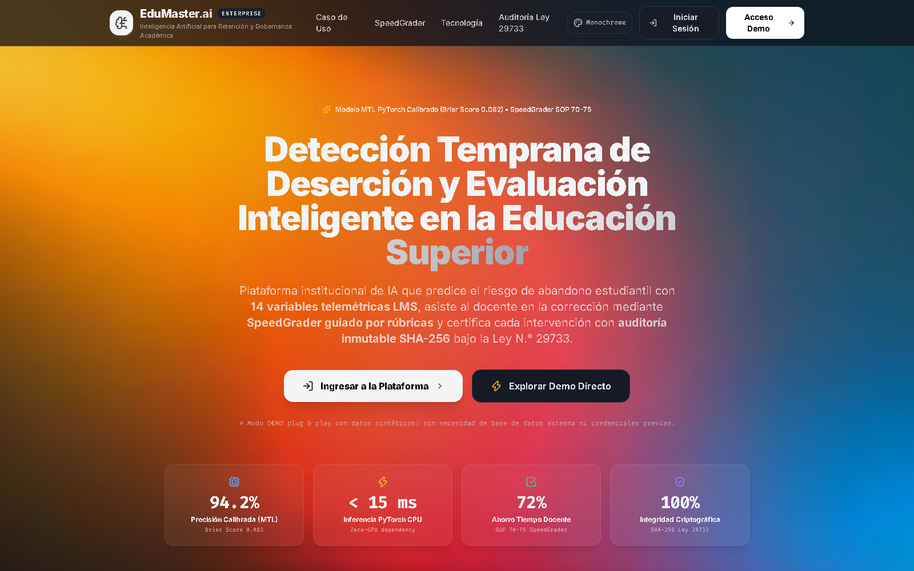

Vista de entrada con propuesta de valor, métricas rotuladas `demo`, accesos `Ingresar a la Plataforma`, `Explorar Demo Directo` e `Ingresar al Login Demo`, y vista previa del producto. No solicita credenciales reales.

### 14.2 Login DEMO

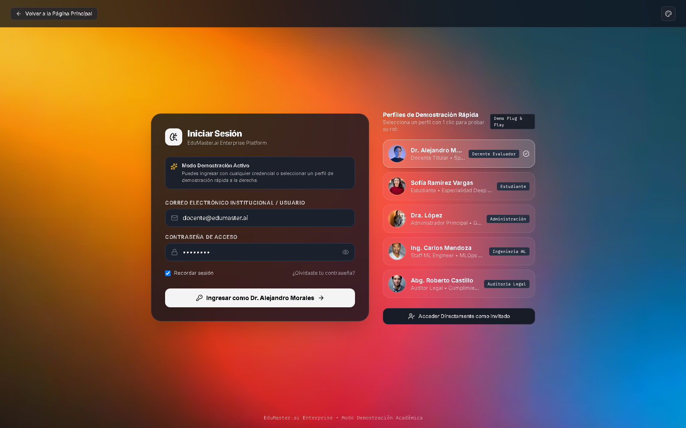

Acceso de un clic con perfiles de administrador, docente y estudiante. Es una simulación para la sustentación: no valida identidad ni usa Supabase/OIDC.

### 14.3 Panel Resumen

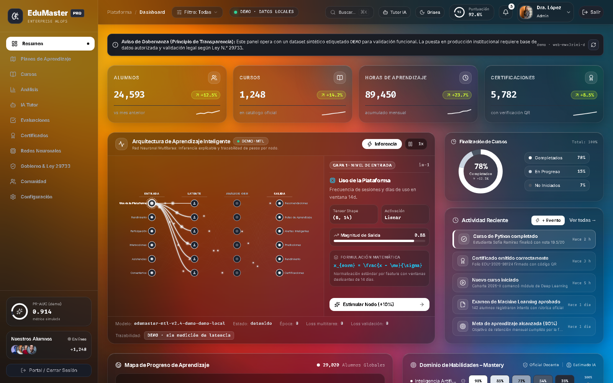

Indicadores, gráfica de avance, mapa global de contorno y visualizador neuronal sobre fondo atmosférico. Las cifras están rotuladas como DEMO.

### 14.4 Notificaciones

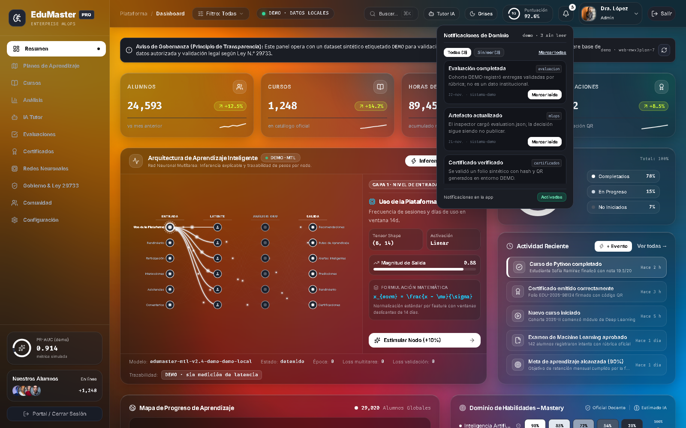

Panel `Notificaciones de Dominio`, filtros `Sin leer (3)`, `Marcar todas` y preferencia `Notificaciones en la app`. Los eventos derivan de la auditoría local.

### 14.5 Comunidad

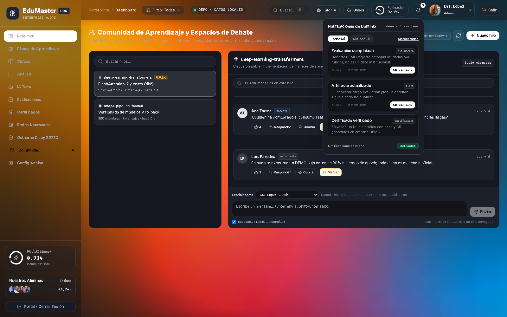

Hilos, mensajes, selector `Escribir como`, respuesta simulada y acciones de edición. No es mensajería real.

### 14.6 Tutor IA

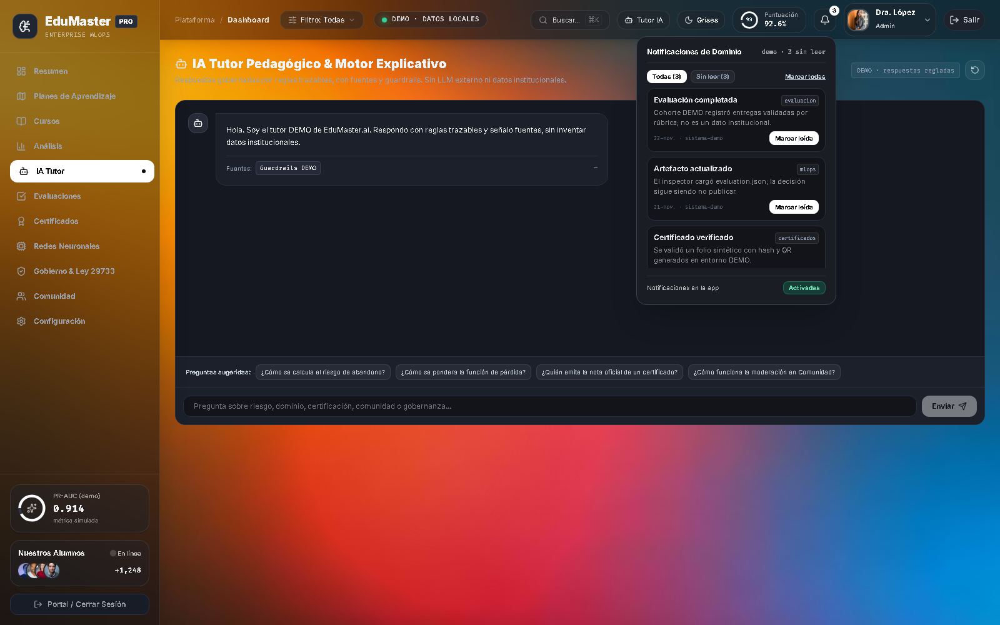

Preguntas sugeridas, `Peso regla DEMO: 86 %` y fuentes clicables. No es un modelo de lenguaje generativo.

### 14.7 Certificados con QR

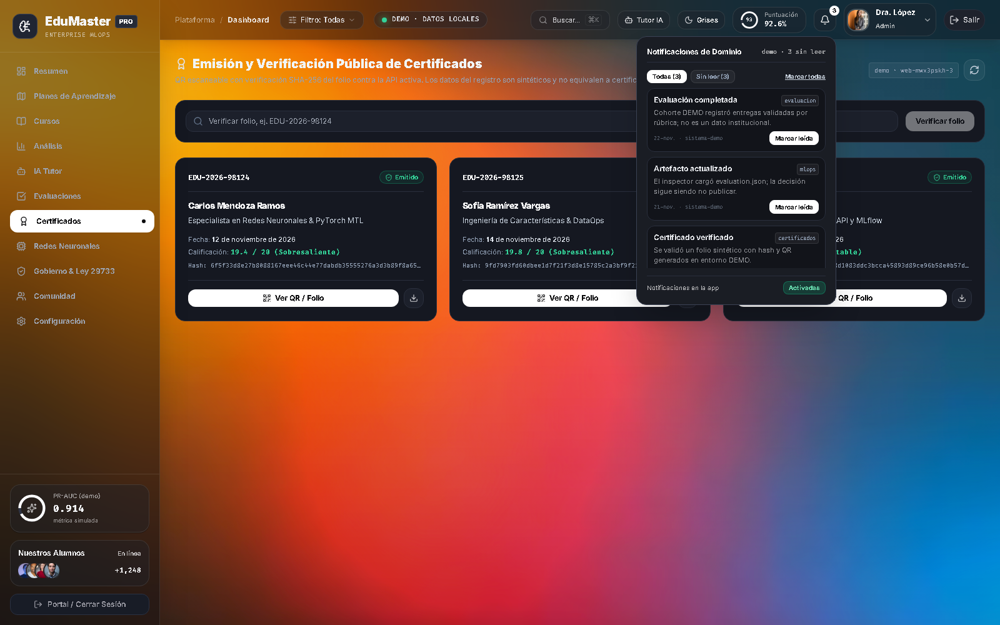

Folio `EDU-2026-98124`, QR PNG y verificación HTTP. El comprobante advierte que no es un certificado oficial.

### 14.8 SpeedGrader

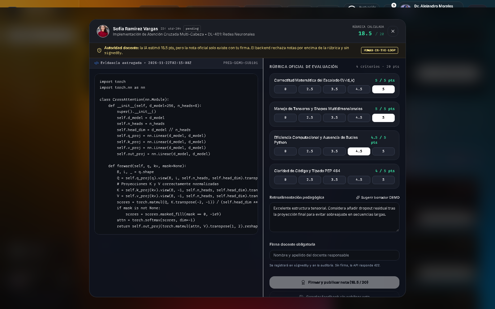

Panel docente con rol `Docente / Instructor`: rúbrica, feedback validado, `X-Actor`, firma y comprobante con `correlation_id`.

### 14.9 Configuración y respaldo DEMO

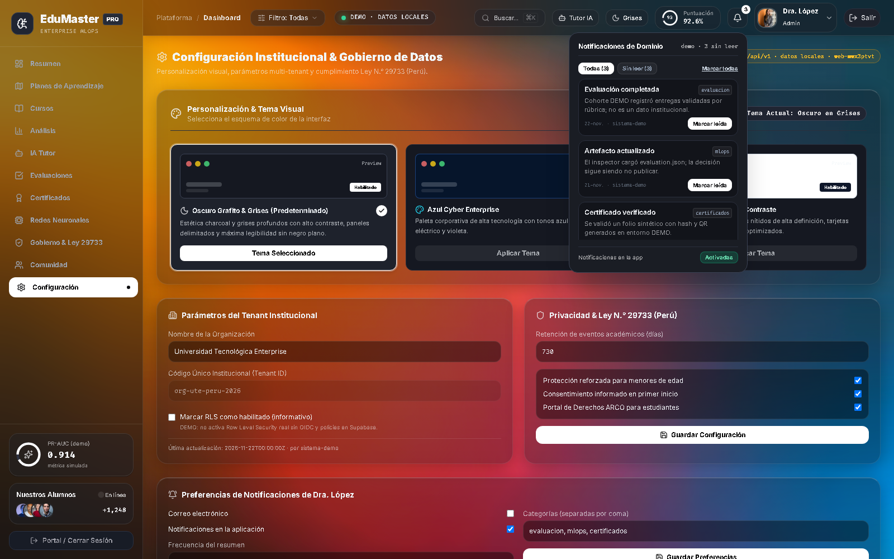

Preferencias compartidas, exportación/importación JSON y badge `DATOS LOCALES DEMO · SIN API /api/v1`.

### 14.10 Auditoría y CSV

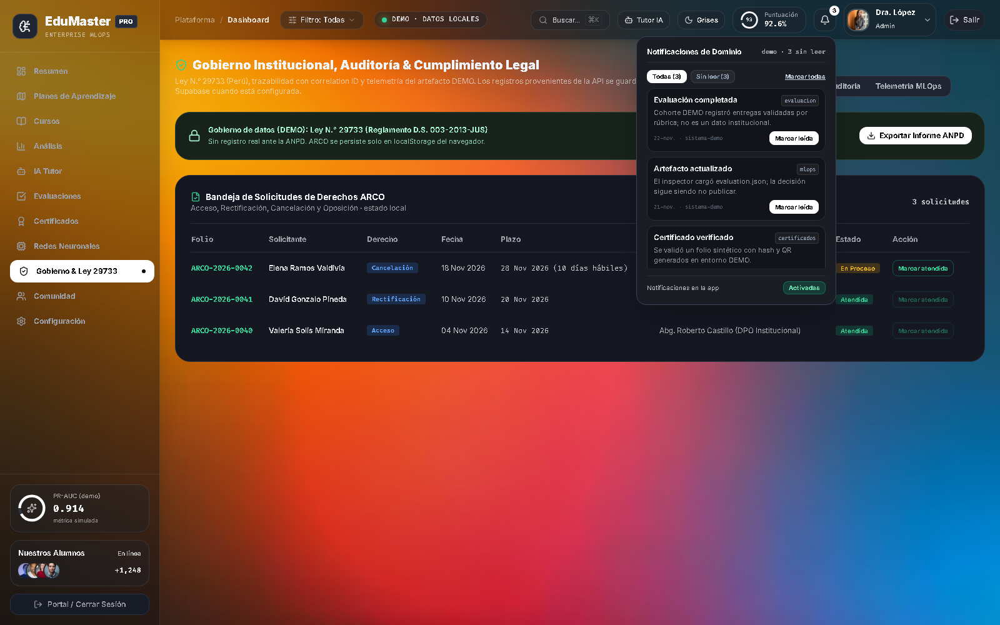

Filtros de auditoría, correlación y descarga real de CSV con BOM UTF-8.

### 14.11 Vista móvil

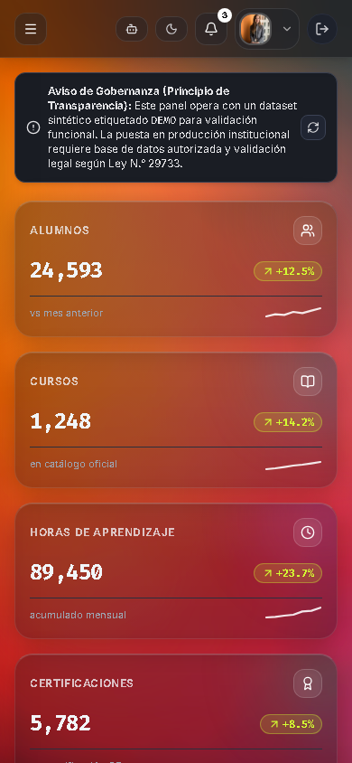

Interfaz adaptada a 390 px con drawer lateral y controles reducidos.

---

## 15. Matriz de cumplimiento y límites honestos

Resultado registrado en `MATRIZ_CUMPLIMIENTO_DOCUMENTO.md`:

| Estado | Cantidad sobre 24 requisitos |
|---|---:|
| ✅ Cumplidos | 5 |
| ◐ Parciales | 8 |
| ❌ No cumplidos | 11 |

### 15.1 Cumplidos de forma verificable

- React 19 + TypeScript + Vite.
- Cambio de “Ingresos” por horas efectivas.
- Rotulación DEMO de métricas y datos.
- QR escaneable con verificación HTTP DEMO.
- CSV reales de auditoría y analítica.

### 15.2 Parciales destacados

- Tailwind sí, pero sin dependencias shadcn/Radix.
- Grafo neuronal animado, pero ilustrativo.
- Auditoría con hash real, pero endpoint público y SQLite local.
- SOPs visibles, pero matrícula y recomendación siguen locales.
- DoD reforzado con 7 E2E, pero sin CI/CD, OWASP, canary ni RPO/RTO.

### 15.3 No cumplidos

- Supabase/OIDC y RLS real.
- WebSocket/SSE reales.
- Control servidor de RBAC/ABAC.
- Vistas materializadas y KPIs servidos desde backend.
- Proceso ARCO real.
- Pruebas de seguridad y despliegue continuo.

### 15.4 Límites que deben decirse en la sustentación

1. Es una demostración académica con datos sintéticos.
2. Los certificados y comprobantes no son oficiales.
3. `confidence`, `Brier` y `PR-AUC` son constantes DEMO.
4. La comunidad no entrega mensajes entre usuarios reales.
5. El Tutor IA usa reglas, no un LLM.
6. No existe autenticación real: `X-Actor` es solo una cabecera opcional.
7. No se hizo deploy: las URLs de Railway aún no existen.

---

## 16. Comandos reproducibles

### 16.1 Windows / PowerShell

```powershell
cd C:\Users\sanhu\Desktop\EduMaster-AI\frontend
npm.cmd run lint
npm.cmd run build
npm.cmd exec playwright install chromium
npm.cmd run test:e2e
python ..\backend\tests\test_smoke.py
```

### 16.2 Servidor estático local

```powershell
cd C:\Users\sanhu\Desktop\EduMaster-AI\frontend
$env:PORT = 4317
npm.cmd run start
```

Abrir:

- `http://127.0.0.1:4317/health`
- `http://127.0.0.1:4317/`

### 16.3 Verificación Git

```powershell
cd C:\Users\sanhu\Desktop\EduMaster-AI
git status --short --branch
git rev-parse HEAD
git rev-parse '@{u}'
git log --oneline --decorate -3
```

### 16.4 Variables recomendadas para Railway

Backend:

```text
DATABASE_URL=<Reference al Postgres de Railway>
ENVIRONMENT=production
PUBLIC_FRONTEND_ORIGIN=https://<TU-FRONTEND>.up.railway.app
```

Frontend:

```text
VITE_CORE_API_BASE_URL=https://<TU-BACKEND>.up.railway.app
```

No definir `VITE_API_BASE_URL` ni `VITE_PUBLIC_ORIGIN`.

---

## 17. Conclusión

EduMaster.ai quedó como una entrega académica coherente y verificable:

- El núcleo de riesgo y SpeedGrader usa HTTP real cuando se configura el backend.
- Los módulos sin backend funcionan con adaptadores DEMO y rotulan su condición.
- La auditoría, el QR, los CSV y el respaldo JSON son funcionales dentro del alcance DEMO.
- Las preferencias se comparten entre pantallas y el estado persiste en el navegador.
- Hay 7 pruebas E2E versionadas, lint limpio, build correcto y smoke test 34/34.
- Las capturas están incluidas en este documento y en el informe de práctica `.docx`.
- El repositorio está sincronizado y el usuario tiene en `RAILWAY.md` la checklist para publicar cuando lo decida.

El proyecto **no se presenta como sistema de producción**. Se entrega como demostración SENATI de cuarto semestre: funcional, trazable, honesta y lista para sustentarse.
